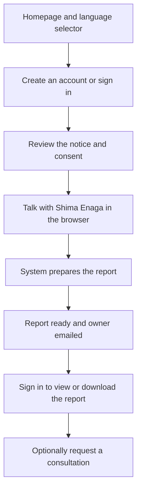

# Owner journey scorecard

Use a fictional family-run Jozankei inn in Sapporo City (札幌市). Start with a new owner account. Have a second owner account and a signed-out browser session available for the access checks.

See the [project overview](../PROJECT.md) for signup fields and report contents. Use the result labels in the [MVP success criteria](mvp-success-criteria-and-agent-scorecards.md). Record whether each interview, analysis, or email check used a live service or a labeled substitute.

| Check | MVP criterion | Pass when | Result | Evidence |
|---|---|---|---|---|
| O1. Enter from the homepage | 1 | The homepage explains what the owner gets and makes signup easy to find. The language selector switches the website between Japanese and English, and the choice persists across pages and later visits. | | |
| O2. Create an account and sign in | 1 | The owner can sign up with just their name, email, business name and municipality. They can leave the contact phone, website and task note empty and sign back in with the account email and password. | | |
| O3. Review consent and start | 2 | The signed-in owner can start when ready. The site identifies Shima Enaga as AI and explains recording, transcription and private report preparation. Capture begins only after consent. Withholding consent prevents capture. | | |
| O4. Complete the browser interview | 2, 3 | The owner can speak with Shima Enaga through the browser. Finishing early stops capture. A separate check confirms capture also stops at the one-hour limit. The completed data reaches the website through the agreed interface and is linked to the correct account. Record whether live research supported a follow-up. | | |
| O5. Return while analysis runs | 4 | Completing the interview starts report preparation automatically. The owner can leave and return. The site shows when the report is still being prepared and when it is ready. If preparation fails, the site shows an unavailable state and sends no report-ready email. | | |
| O6. Read the report | 4 | The report maps the current booking and cleaning process and diagrams a proposed workflow alongside it. Recommendations are ranked, with time spent, potential savings, estimated implementation effort and costs, and the basis for estimates. Where useful, compare existing tools with custom work. Record the language the report was written in; the project overview lists the generated report language as an open delivery claim. | | |
| O7. Use the email and download | 5 | The owner receives one ready email with a link to the report. The link requires sign-in, and the owner can view and download their own report. Check that a signed-out visitor and another owner cannot view or download it. The owner can choose to share the downloaded copy. | | |
| O8. Decide on follow-up | 6 | The owner can finish the journey after reading the report or choose to request a consultation. If they request one, the owner sees that the request was recorded, and designated staff can see the request. Requesting again does not error. | | |

### Returning and cross-role checks

The first pass above walks one uninterrupted session. These checks cover repeat visits and the access gates on the interview page itself.

| Check | MVP criterion | Pass when | Result | Evidence |
|---|---|---|---|---|
| O9. Sign out and come back | 1, 5 | The owner signs out, signs back in with the email and password, and reaches the report again from the interview page's completed state. Reopening the interview after completing it shows the completed state with the link to the existing report rather than a fresh consent gate. | | |
| O10. Resume an interrupted interview | 2 | If the owner leaves mid-interview and returns, the page restores the saved draft and says so. If the interview state fails to load, the page offers a retry, and retrying recovers without losing the draft. | | |
| O11. Interview page gates | 2, 6 | A signed-out visitor who opens the interview page is asked to sign in and is returned to the interview afterwards. A staff account that opens the interview page sees a notice and cannot start an interview. | | |

Hand off the finished report and, if requested, the consultation to the [staff and advisor scorecard](staff-journey-scorecard.md) so the lead can verify both sides of the same case.
