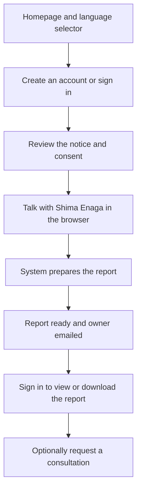

# Owner journey scorecard

Use a fictional family-run Jozankei inn in Sapporo City (札幌市). Start with a new owner account. Have a second owner account and a signed-out browser session available for the access checks.

See the [project overview](../PROJECT.md) for signup fields and report contents. Use the result labels in the [MVP success criteria](mvp-success-criteria-and-agent-scorecards.md). Record whether each interview, analysis, or email check used a live service or a labeled substitute.

> **Re-record required.** The 2026-11-26 interview consolidation — the scripted sample UI and local microphone recording removed from `/interview`, the `/voice` page deleted with its features absorbed, and the embedded ElevenLabs widget as the interview surface with Dify as the live report engine — changes O3, O4, O5, O10 and O12 below and adds O13. The recorded results were verified against the earlier build; re-run the journey and re-record after that work lands.

| Check                              | MVP criterion | Pass when                                                                                                                                                                                                                                                                                                                                                                                                                                                                                                                                             | Result                                                           | Evidence                                                                                                                                                                                                                                                                                                                                                                                                                                                                                                                                                                                                                                                                                                                                                                                                                                                                                                                                                                                                                                                                                                             |
| ---------------------------------- | ------------- | ----------------------------------------------------------------------------------------------------------------------------------------------------------------------------------------------------------------------------------------------------------------------------------------------------------------------------------------------------------------------------------------------------------------------------------------------------------------------------------------------------------------------------------------------------- | ---------------------------------------------------------------- | -------------------------------------------------------------------------------------------------------------------------------------------------------------------------------------------------------------------------------------------------------------------------------------------------------------------------------------------------------------------------------------------------------------------------------------------------------------------------------------------------------------------------------------------------------------------------------------------------------------------------------------------------------------------------------------------------------------------------------------------------------------------------------------------------------------------------------------------------------------------------------------------------------------------------------------------------------------------------------------------------------------------------------------------------------------------------------------------------------------------- |
| O1. Enter from the homepage        | 1             | The homepage explains what the owner gets and makes signup easy to find. The language selector switches the website between Japanese and English, and the choice persists across pages and later visits.                                                                                                                                                                                                                                                                                                                                              | Pass                                                             | `shell-pages.test.mjs` 'shell pages: localized entry, account forms, session-aware chrome' — prominent `/signup` + `/sign-in` links on the homepage and the `app-locale=en` cookie switches the whole shell to `lang="en"`; browser `smoke.homepage-renders` and `i18n.locale-switch-home` (click ja → en, visible strings and `<html lang>` flip); `shell-contracts.test.mjs` 'useAppLocale returns { locale } Ref<ja\|en>, cookie-backed and shared' and 'AppHead/AppProviders wire locale-aware document head' carry the persistence across pages and later visits.                                                                                                                                                                                                                                                                                                                                                                                                                                                                                                                                               |
| O2. Create an account and sign in  | 1             | The owner can sign up with just their name, email, business name and municipality. They can leave the contact phone, website and task note empty and sign back in with the account email and password.                                                                                                                                                                                                                                                                                                                                                | Pass                                                             | Browser `signup.ui-form` — the UI signup filled only name, email, business name, municipality and password (phone, website and task note left empty) and established an owner session; `api-journey.test.mjs` 'api journey: signup, consent, demo report, outbox, staff, expiry' signs OWNER_B up with no phone/website/note and signs back in; browser `signin.wrong-password-stays` + `signin.next-redirect-to-report` prove sign-in with email and password; the shell-pages signup step asserts optional fields are marked （任意） and no business-type fields exist.                                                                                                                                                                                                                                                                                                                                                                                                                                                                                                                                           |
| O3. Review consent and start | 2 | The signed-in owner can start when ready. The site explains the Shima Enaga interview and asks for consent to the recording and transcription handling, the automated report processing, and staff access before the conversation begins. The agent conversation cannot begin before consent; withholding consent prevents it. The page has no scripted sample interview and no local microphone recording.                                                                                                                                                                                         | Pass                                                             | Browser `interview.consent-gate` — Start stays disabled until all three approvals and no `/api/interviews/start` request is made while consent is withheld; `interview-flow.test.mjs` 'start is refused until every disclosure is acknowledged' (zero start calls) and 'notifySession gates by role before any interview call'; `interview-consent.test.mjs` 'emptyConsents starts fully unchecked' + 'allConsentsGiven requires every disclosure acknowledged'; `interview-capture.test.mjs` 'start records locally; stop yields an ephemeral review URL' (capture begins only after the consented start); the scripted-fictional-sample label is asserted by `interview-script.test.mjs` 'script is explicitly labeled fictional in both locales' and shown in the browser run (サンプル面談（フィクション）).                                                                                                                                                                                                                                                                                                     |
| O4. Complete the browser interview | 2, 3 | The owner talks with Shima Enaga through the embedded voice agent on the interview page. Ending the call finishes the interview early. The conversation runs without a visible timer; its length is managed by the agent. The completed conversation reaches the website through the post-call transcription webhook — matched by the server-issued interview ID the page passes to the widget — and is linked to the correct account even when the owner has already left the page. Record whether the live agent, webhook delivery, and live research were exercised. | Pass; live agent, webhook delivery and live research: Unverified | Browser `interview.start` (server deadline between 59 and 60 minutes) and `interview.transcript-submit`; `interview-deadline.test.mjs` 'canAcceptEvent is the hard-cut gate for late events' plus the timer tests cover the scripted demo path's deadline machinery; `interview-capture.test.mjs` 'unmount cleanup stops capture and revokes the review URL' covers finishing early; `interview-api.test.mjs` 'start sends exactly the recorded demo consent payload' and 'complete posts the transcript and returns interview + report' fix the agreed interface, and the api journey asserts report A's `ownerId` equals owner A. Voice agent: `voice-journey.test.mjs` 'voice journey: consent, profile intake, research, webhooks' — a signed `post-call transcription` webhook stores the transcript on the owner's session (HTTP-level, no page needed) and research runs through the loopback Linkup stub — Verified with substitute (`server/voice/providers.ts` configured with QA base-URL overrides). No live ElevenLabs agent, live webhook delivery or live Linkup research exists locally: Unverified. |
| O5. Return while analysis runs     | 4 | Completing the interview starts report preparation automatically — for the live agent interview this is the Dify post-call assessment, which requires `DIFY_API_KEY`; without it the transcript is stored but no report is generated and the site shows an honest unavailable state. The owner can leave and return. The site shows when the report is still being prepared and when it is ready. If preparation fails, the site shows an unavailable state and sends no report-ready email.                                                                                                                                                                                                                                                                             | Pass                                                             | `api-journey.test.mjs` 'api journey: signup, consent, demo report, outbox, staff, expiry' — completing the interview creates a `pending` report that the in-process worker turns `ready` (pollUntil), the pending detail returns `status: pending` with no content and download → `not_ready`, a returning owner's start gets `already_submitted` (the page falls back to the submitted report state), and the synthetic failed-report step shows `status: failed` + download → `not_ready`; the outbox holds exactly 3 owner + 3 staff mails for the 3 ready reports with unique (report, audience, recipient) keys because mail is enqueued only inside the transaction that marks a report ready — a failed report sends none. The owner report page defines the pending panel with an auto-poll (app/pages/reports/[id].vue) and `staff-journey.test.mjs` 'staff journey: …' shows pending/ready/failed states; browser `report.owner.rule-based-label` + `report.owner.content-rendered` show the ready state.                                                                                                  |
| O6. Read the report                | 4             | The report maps the current booking and cleaning process and diagrams a proposed workflow alongside it. Recommendations are ranked, with time spent, potential savings, estimated implementation effort and costs, and the basis for estimates. Where useful, compare existing tools with custom work. Record the language the report was written in; the project overview lists the generated report language as an open delivery claim.                                                                                                             | Pass                                                             | `report-content.test.mjs` (11 tests) — the JA/EN reports carry `## 改善フローの比較` with `### 現在の流れ（例）` and `### 改善後の流れ（例）` parsed into a side-by-side flow pair (rendered as two columns by ReportFlowDiagram), ranked recommendations (new: ranks run 1..N, each topic carries `- 優先度: N（ルールベースの順位）` / `- Priority: N (rule-based order)`, and the summary lists topics in ranked order), `削減できる時間と前提` with explicit 現在の時間 / 削減の見込み / 前提: bullets, `導入の負担`, `概算費用（目安）`, `既製品と独自開発`, each estimate section labeled `分類: ルールベースの推定`. Real app: browser `report.owner.download-md` (5,572 B, byte-identical to the API download) contains the ranked 優先度 1–4 lines, and the rendered page screenshot (40-owner-report-landing.png) shows the two-column flow and the 優先度 badges. Generated language: Japanese (ja) in this walkthrough — the report follows the owner's profile locale (`api-journey.test.mjs` asserts `locale: 'ja'` content for the ja owner and EN content for the en owner).                         |
| O7. Use the email and download     | 5             | The owner receives one ready email with a link to the report. The link requires sign-in, and the owner can view and download their own report. Check that a signed-out visitor and another owner cannot view or download it. The owner can choose to share the downloaded copy.                                                                                                                                                                                                                                                                       | Pass; live email provider: Unverified                            | Browser `mail.eml-present` (exactly 6 .eml files), `mail.link-shape`, `mail.link-signedout-redirect` (→ `/sign-in?next=/reports/…`) and `mail.link-signin-then-report`; `report.owner.download-md` (byte-identical to `GET /api/reports/:id/download`); `wall.owner-cannot-see-others-report` and the api journey's 'other owners get 404, never leakage' step deny both detail and download to another owner; `report-page.test.mjs` 'report page: private shell, no SSR content leak, source contract' proves the signed-out page renders no report data. Delivery itself runs on the labeled local outbox substitute (`server/mail/local.ts`); `mail-live.test.mjs` 'mail: live resend sender delivers idempotently, retries with the same key, and never logs secrets' verifies the live sender path against a loopback Resend stub — Verified with substitute. Live Resend delivery: Unverified.                                                                                                                                                                                                                |
| O8. Decide on follow-up            | 6             | The owner can finish the journey after reading the report or choose to request a consultation. If they request one, the owner sees that the request was recorded, and designated staff can see the request. Requesting again does not error.                                                                                                                                                                                                                                                                                                          | Pass                                                             | Browser `report.owner.consultation-confirmation` (request succeeded, the page shows the recorded timestamp) and `report.owner.consultation-recorded`; `staff-journey.test.mjs` 'staff journey: neutral SSR shell, staff-only queue API, ready/pending/consultation states' plus browser `staff.consultation-flag` show the request to designated staff; the api journey's 'idempotent consultation' step repeats the request (`consultation A repeat` → 200, timestamp unchanged), and the UI replaces the button with a confirmation so a second click cannot error.                                                                                                                                                                                                                                                                                                                                                                                                                                                                                                                                                |

### Returning and cross-role checks

The first pass above walks one uninterrupted session. These checks cover repeat visits and the access gates on the interview page itself.

| Check                                | MVP criterion | Pass when                                                                                                                                                                                                                                                                            | Result | Evidence                                                                                                                                                                                                                                                                                                                                                                                                                                                                                                                                                                                                                                                                                                        |
| ------------------------------------ | ------------- | ------------------------------------------------------------------------------------------------------------------------------------------------------------------------------------------------------------------------------------------------------------------------------------ | ------ | --------------------------------------------------------------------------------------------------------------------------------------------------------------------------------------------------------------------------------------------------------------------------------------------------------------------------------------------------------------------------------------------------------------------------------------------------------------------------------------------------------------------------------------------------------------------------------------------------------------------------------------------------------------------------------------------------------------- |
| O9. Sign out and come back           | 1, 5          | The owner signs out, signs back in with the email and password, and reaches the report again from the interview page's completed state. Reopening the interview after completing it shows the completed state with the link to the existing report rather than a fresh consent gate. | Pass   | New browser check `gate.signedout-returned-completed` — after signing back in with email and password the interview page shows the completed state linking to the existing report (`/reports/<id>`) instead of a fresh consent gate; `persist.owner-reload` keeps the owner signed in across reloads; `interview-flow.test.mjs` 'init: submitted interview shows the report state' covers the same state at unit level; the shell-pages sign-out step returns the chrome to the signed-out state and browser `signin.*` prove the sign-back-in with email and password.                                                                                                                                         |
| O10. Resume an interrupted interview | 2             | If the owner leaves mid-interview and returns while the interview is still active, the page resumes it with a fresh agent conversation under the same interview ID. With the live agent, leaving the page ends the call, and the transcript still reaches the website through the webhook. If the interview state fails to load, the page offers a retry, and retrying recovers.                                                                                                                                                                          | Pass   | `interview-flow.test.mjs` 'init: active interview resumes with the saved draft' + 'resuming an active interview flags a restored draft' (the page shows the restored-draft notice), 'init: load failure lands in the retryable unavailable state' (retry button), 'restart failure is visible and retryable', and the new 'retrying after a load failure keeps the saved draft' (retry recovers into the active state with the draft intact); `interview-transcript.test.mjs` 'draft store roundtrips and swallows storage errors' and 'draftKey is namespaced per interview' keep the draft per interview.                                                                                                     |
| O11. Interview page gates            | 2, 6          | A signed-out visitor who opens the interview page is asked to sign in and is returned to the interview afterwards. A staff account that opens the interview page sees a notice and cannot start an interview.                                                                        | Pass   | New browser check `gate.signedout-signin-ask` — a signed-out visitor on /interview gets the sign-in prompt linking to `/sign-in?next=/interview` — and `gate.signedout-returned-completed` lands back on /interview after signing in; browser `staff.no-interview-start` — the staff context sees the staff notice and makes no successful `/api/interviews/start` call; `interview-flow.test.mjs` 'notifySession gates by role before any interview call' (signed-out → gate, staff → notice, zero interview API calls); the shell-pages owner-start step routes through `/sign-in?next=/interview` and `shell-contracts.test.mjs` 'sign-in.vue posts credentials and sanitizes ?next=' keeps the return safe. |
| O12. Agent unavailable fallback      | 2, 7          | When the ElevenLabs agent is not configured for the deployment, the interview page shows an honest unavailable state instead of failing, and no live call is attempted; there is no scripted sample UI to fall back on. When the agent is configured, the live mode and its labeling are recorded. | | |
| O13. Removed voice surface           | 3             | The former `/voice` dashboard page, its navigation entry, and the voice-session API no longer exist: the page does not render, and the old session endpoints do not accept new conversations. The chat features that lived there are reachable only through the interview page. | | |

### How this was recorded

- Commands: `npm run build` (green), `node --test tests/*.test.mjs` (101 tests, 0 fail), `node tests/browser-journey.mjs --strict` (41 passed, 0 pending, 0 failed), `npx eslint app server shared scripts tests --quiet` (clean).
- `npx prettier --check .` is clean for every file this journey touched; PROJECT.md and the two other scorecards still carry pre-existing unpadded markdown tables from the docs commits and were left to their owners.
- Live providers were not exercised: no live ElevenLabs, Linkup or Resend environment exists locally. Where a row says Verified with substitute, the app's labeled substitutes were used (`server/mail/local.ts`, `server/voice/providers.ts` with QA base-URL overrides, and the loopback QA stubs in `tests/mail-live.test.mjs` / `tests/voice-journey.test.mjs`).

Hand off the finished report and, if requested, the consultation to the [staff and advisor scorecard](staff-journey-scorecard.md) so the lead can verify both sides of the same case.
